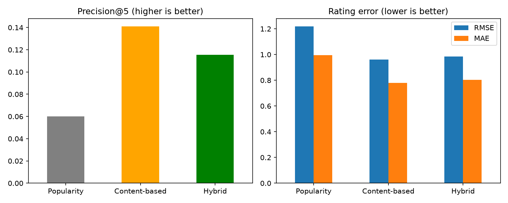
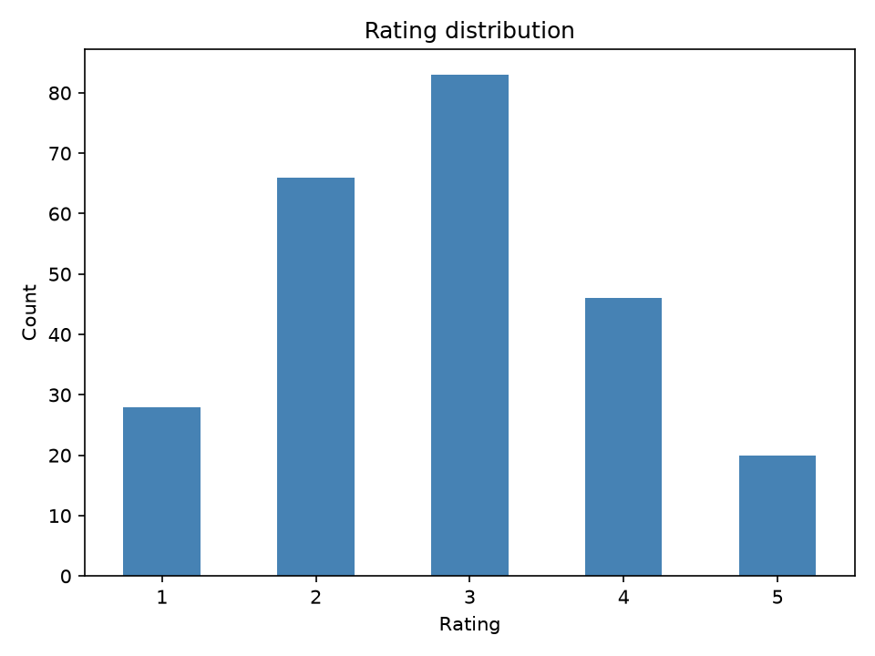
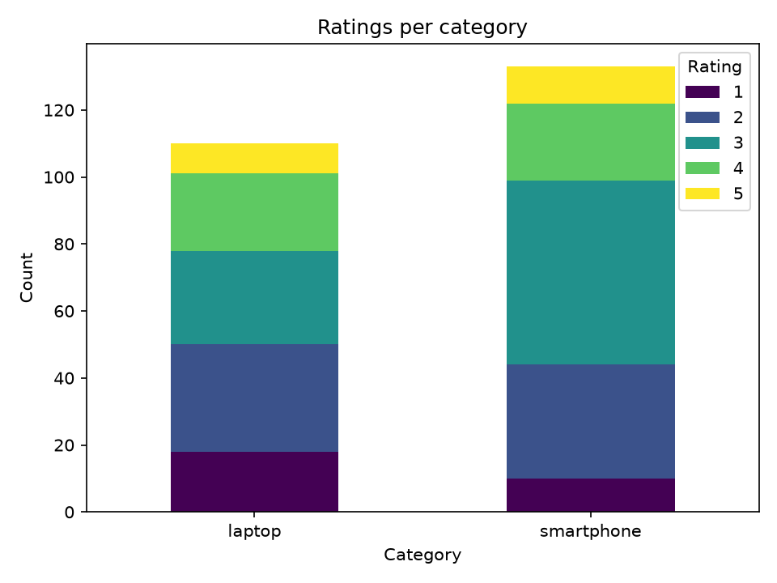

# Smartphone and Laptop Gadget Recommender

| | |
|---|---|
| **Student Name** | Nguyễn Đăng Thành |
| **Student ID / Section** | 29211358775 / CS467A (No. 15) |
| **Course** | CS467 Advanced Artificial Intelligence, Duy Tan University, 2026-2027 |
| **Instructor** | Puri Vikram |
| **Project** | MP-A15: Smartphone and Laptop Gadget Recommender (Consumer Electronics Retail) |

## 1. Problem Statement

Customers shopping for phones or laptops usually describe how they plan to use a device
("lightweight student laptop with long battery for coding") instead of quoting hardware specs.
This project builds a small recommender that uses NLP on spec summaries and buyer reviews to
turn such free-text needs, or a user's rating history, into Top-5 device recommendations with
scores and keyword explanations.

## 2. Dataset

| File | Content |
|---|---|
| `data/items.csv` | 40 devices (20 laptops, 20 smartphones): `item_id, model_name, category, price_usd, spec_summary, highlights_tags` |
| `data/ratings.csv` | 243 ratings from 14 users (16-20 ratings each): `user_id, item_id, rating (1-5), buyer_review` |

- Matrix sparsity: 14 users x 40 items = 560 cells, 243 rated, so **57% missing**. Every item has at least 2 ratings.
- **Items:** specs and prices are approximate summaries written from public manufacturer / review-site information (e.g. apple.com, samsung.com, GSMArena, Notebookcheck). Prices are rounded and may differ from real prices.
- **Ratings and reviews are synthetic.** They were generated by `data/make_ratings.py` (fixed seed 42) from 14 user personas (coding student, gamer, photographer, budget buyer, ...). A rating depends on how many of the persona's preferred tags the device has and on the persona's budget, and the review text is built from templates that match the rating. They are not real customer data.

## 3. Methods

### NLP (`src/nlp_pipeline.py`)
- **Preprocessing:** lowercase, remove punctuation and extra spaces, tokenize, remove stop words, map a few synonyms (`programming` -> `coding`, `light` -> `lightweight`).
- **TF-IDF:** item text = model name + category + spec summary + tags + the item's positive buyer reviews (rating >= 4, taken only from the ratings given to the model, so test reviews never leak into training), vectorized with unigrams + bigrams and sublinear tf.
- **Query vectorization:** `TextModel.transform(text)` reuses the fitted vocabulary for any new query or new item description.
- **Sentiment:** lexicon based, `(pros - cons) / (pros + cons)` in [-1, 1]; a negator ("not") flips the next sentiment words. Item sentiment = mean over its reviews, rescaled to [0, 1].
- **Keywords:** the terms with the largest TF-IDF overlap between the query/profile and the item explain each recommendation.
- **Pros/cons:** the most frequent positive and negative lexicon words in each item's reviews are shown next to every recommendation (`pros_cons` column, e.g. `+ great, long | - laggy, slow`).

### Recommenders (`src/recommender.py`)
1. **Popularity baseline:** weighted rating `v/(v+m) * mean + m/(v+m) * C` (m = 2 minimum ratings, C = global mean); items the user already rated are removed.
2. **NLP content-based:** cosine similarity `cos(a, b) = a.b / (|a||b|)` between TF-IDF vectors. Supports (a) free-text queries, (b) item-to-item similarity, (c) user profile = sum of liked items' vectors (rating >= 4) weighted by `rating - 2`.
3. **Hybrid (extension):** for a user, `0.5 * content + 0.3 * item-based CF + 0.2 * sentiment`. Item-based CF predicts a rating as the similarity-weighted average of the user's ratings, with adjusted-cosine item similarity on mean-centered ratings. For a free-text query, `0.8 * content + 0.2 * sentiment`. Items with no ratings (cold start) get CF = 0 and neutral sentiment, so they are ranked by content.

## 4. Installation and Run

```powershell
python -m venv venv
.\venv\Scripts\activate
pip install -r requirements.txt

python data\make_ratings.py            # optional: regenerates ratings.csv (overwrites it)
python src\main.py                     # runs the 3 test cases, saves results\sample_outputs.txt
python src\main.py --user U01          # recommendations for a user (all 3 methods)
python src\main.py --query "phone with great camera and long battery"
python src\evaluate.py                 # evaluation table + charts in results\
```

An unknown user ID (e.g. `--user U99`) is reported as a cold-start user and gets the Popularity baseline only.
An interactive walkthrough is available in `notebooks/demo.ipynb`.

## 5. Sample Outputs (3 required test cases)

Full output: [`results/sample_outputs.txt`](results/sample_outputs.txt)

**Test 1: use-case query** "lightweight student laptop with long battery for coding"

| model | score | keywords | pros / cons |
|---|---|---|---|
| HP Pavilion Aero 13 | 0.893 | coding, student, lightweight | + great, good / - slow, laggy |
| MacBook Air 13 M2 | 0.848 | coding, lightweight, long battery | + great, smooth / - laggy, dim |
| ASUS Zenbook 14 OLED | 0.797 | lightweight, long battery, long | + great, long / - laggy, slow |
| Acer Swift Go 14 | 0.796 | student, lightweight, long battery | + great, bright / - laggy, hot |
| Acer Chromebook Spin 714 | 0.792 | long battery, long, lightweight | + great, long / - laggy, slow |

**Test 2: alternatives to Samsung Galaxy S24 (P05)**

| model | score | keywords | pros / cons |
|---|---|---|---|
| Samsung Galaxy S24 Ultra | 0.301 | flagship, camera, s24 | + long, great / - bulky, expensive |
| Xiaomi 14 | 0.196 | compact, triple camera, triple | + decent, sharp / - weak, drains |
| iPhone 15 Pro | 0.190 | flagship, camera, love | + sharp, bright / - weak, drains |
| Samsung Galaxy A55 | 0.154 | display 50mp, samsung, samsung galaxy | + great, long / - heavy, bulky |
| Samsung Galaxy Z Flip5 | 0.134 | compact, samsung galaxy, samsung | + bright, sharp / - expensive, buggy |

**Test 3: cold start.** A new laptop "NovaBook Lite 14" (L99) is added with spec text only and no ratings.
It is ranked **#1** for the same query as Test 1 (score 0.900, "no reviews yet"), so `L99 recommended in Top-5: True`.

Note: pros/cons words come from reviews written by different personas, so one device can show both
positive and negative words (e.g. `+ great` and `- laggy`).

## 6. Evaluation

Each user's ratings are split: about 20% (at least 2) are hidden as test data. Precision@5 counts hidden items
rated >= 4 that appear in the Top-5 (users without such items are skipped). RMSE/MAE are computed on all hidden ratings.
Results are averaged over 20 random splits.

| Method | Precision@5 | RMSE | MAE |
|---|---|---|---|
| Popularity | 0.060 | 1.220 | 0.995 |
| Content-based | 0.141 | 0.960 | 0.779 |
| Hybrid | 0.115 | 0.985 | 0.802 |





## 7. Reflection

**What worked well**
- Both NLP-based methods clearly beat the popularity baseline (Precision@5 about 2x, lower RMSE/MAE), because users have distinct tastes that a single global ranking cannot capture. Adding positive reviews to the TF-IDF text gave the content-based model a small gain (Precision@5 0.133 -> 0.141 in my experiment), though such a difference is within the noise of this small dataset.
- Free-text queries return sensible results, with keywords that explain each recommendation.
- The cold-start laptop is recommended immediately because content similarity needs no ratings.

**Limitations**
- The Hybrid did **not** beat the Content-based method here (0.115 vs 0.141, a difference within the noise of such a small dataset). With only 14 users and 40 items, item-based CF has little signal, and the synthetic ratings are mostly driven by tags that the content model already sees. I tried other weights; none gave a reliable improvement, so I kept the 0.5/0.3/0.2 weights.
- Ratings and reviews are synthetic, so the absolute numbers are only illustrative. Review sentiment is very polarized (1-2 star reviews score -1.0), unlike real reviews.
- The sentiment lexicon is small and handles only simple negation.
- Precision@5 is low in absolute terms because there are very few hidden relevant items per user.

**Future work:** real review data, a larger lexicon or a trained sentiment model, and tuning the hybrid weights with cross-validation.

## 8. Project Structure

```
data/        items.csv, ratings.csv, make_ratings.py
src/         nlp_pipeline.py, recommender.py, evaluate.py, main.py
notebooks/   demo.ipynb
results/     sample_outputs.txt, evaluation_table.csv, *.png
```
